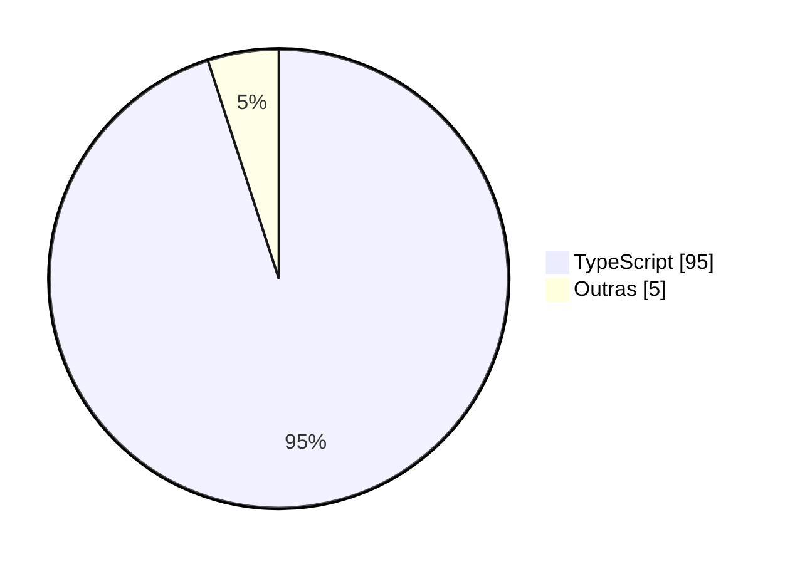

# Olá, eu sou o Felipe 👋

Sou desenvolvedor full stack na Inovai, a agência de inovação de Itajubá, e estudante de Sistemas de Informação na UNIFEI, no 4º período.

## 🚀 No momento

- Fazendo a capacitação de desenvolvimento desktop da Asimov Jr. ([acompanhe aqui](https://github.com/felipesouzx/capacitacao-asimov-felipe-souza))

## 🛠️ Tecnologias

## 📊 Linguagens mais usadas

Estimativa com base no meu principal projeto privado.

## 📌 Projetos

- **[Sistema de Biblioteca Escolar](https://github.com/felipesouzx/XDES04-TrabalhoFinal):** trabalho em equipe da disciplina de Engenharia de Software I.

## 🏆 Conquistas

- Fiz parte do time campeão mundial da Batalha de Cases no ENEJ + JEWC 2026, com uma solução de software e IA para mapeamento de árvores e espaços verdes.
- O Centro de Empreendedorismo Unifei, onde sou agente de inovação, ficou em 2º lugar mundial em Community Engagement no Triple E Awards 2025.

## 📫 Contato

[LinkedIn](https://www.linkedin.com/in/felipe-augustodev) • [E-mail](mailto:felipeaugustosb@outlook.com)
